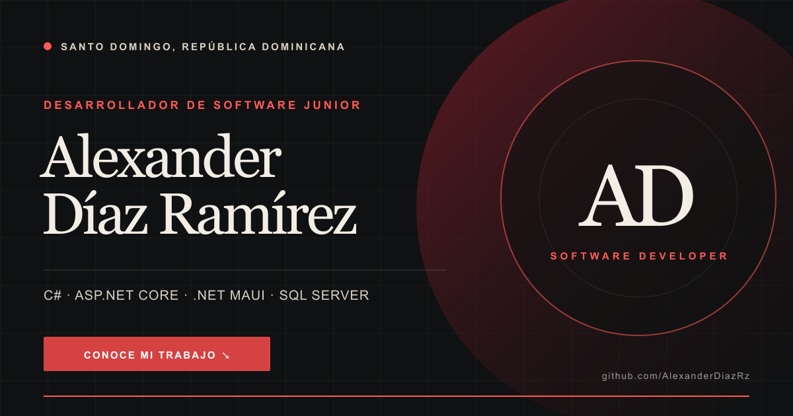

# Portafolio de Alexander Díaz Ramírez

Portafolio profesional de **Alexander Díaz Ramírez**, desarrollador de software junior y estudiante de término de Ingeniería en Software en Santo Domingo, República Dominicana.



## Sobre el proyecto

Sitio desarrollado con ASP.NET Core MVC para presentar proyectos, experiencia, habilidades, formación y medios de contacto. El diseño utiliza una dirección editorial oscura con acentos rojos, composición responsiva y recursos visuales propios para cada proyecto.

El contenido distingue de forma clara los repositorios públicos, los trabajos privados y los proyectos desarrollados en equipo. No contiene credenciales, datos de clientes ni información operativa privada.

## Tecnologías

- C# y ASP.NET Core MVC
- .NET 10
- Razor Views
- HTML, CSS y JavaScript
- Docker

## Ejecutar localmente

Requisitos:

- .NET 10 SDK

```bash
dotnet restore
dotnet run --urls http://localhost:5188
```

Luego abre <http://localhost:5188>.

## Ejecutar con Docker

```bash
docker build -t alexander-portfolio .
docker run --rm -p 8080:8080 alexander-portfolio
```

Luego abre <http://localhost:8080>.

## Contenido destacado

- Experiencia actual en el desarrollo de GoGo Delivery RD.
- Proyectos web con ASP.NET Core MVC y bases de datos.
- Desarrollo móvil con .NET MAUI y Flutter.
- Integración de modelos locales con Ollama.
- Formación técnica y complementaria confirmada.

## Contacto

- GitHub: [AlexanderDiazRz](https://github.com/AlexanderDiazRz)
- Correo: [alexanderadr1298@gmail.com](mailto:alexanderadr1298@gmail.com)
- Ubicación: Santo Domingo, República Dominicana

